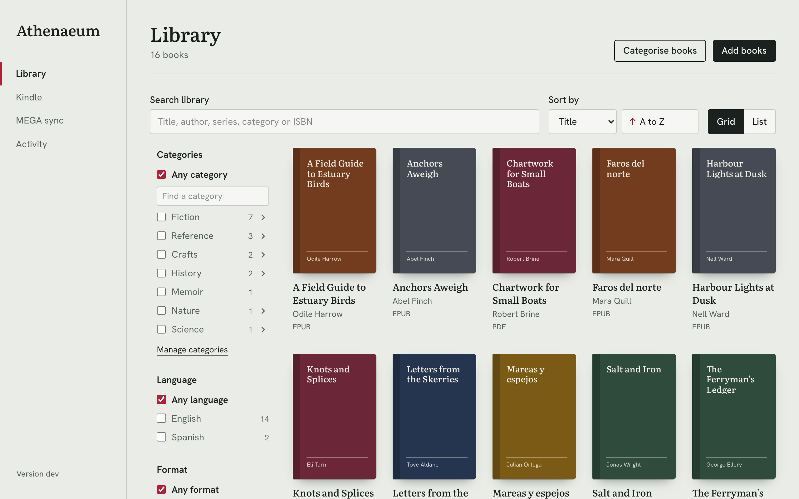
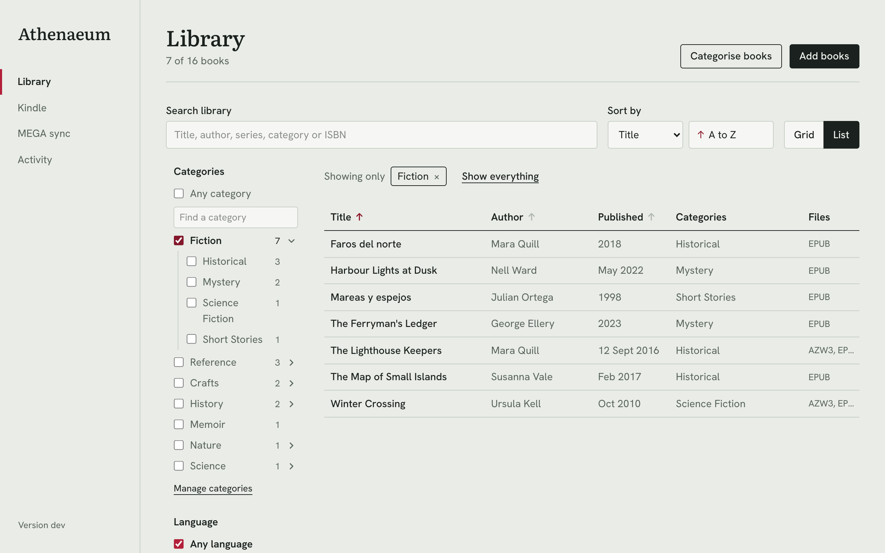
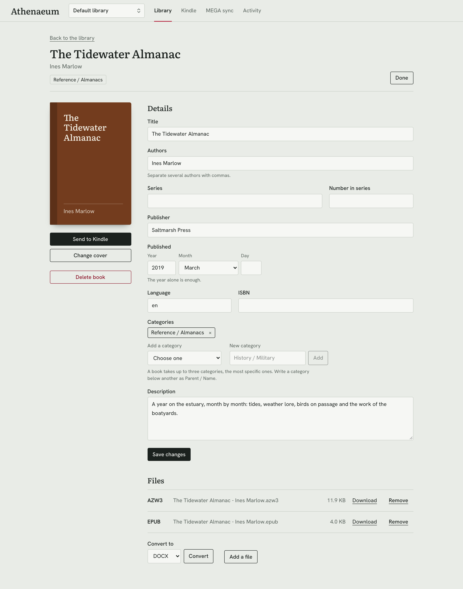
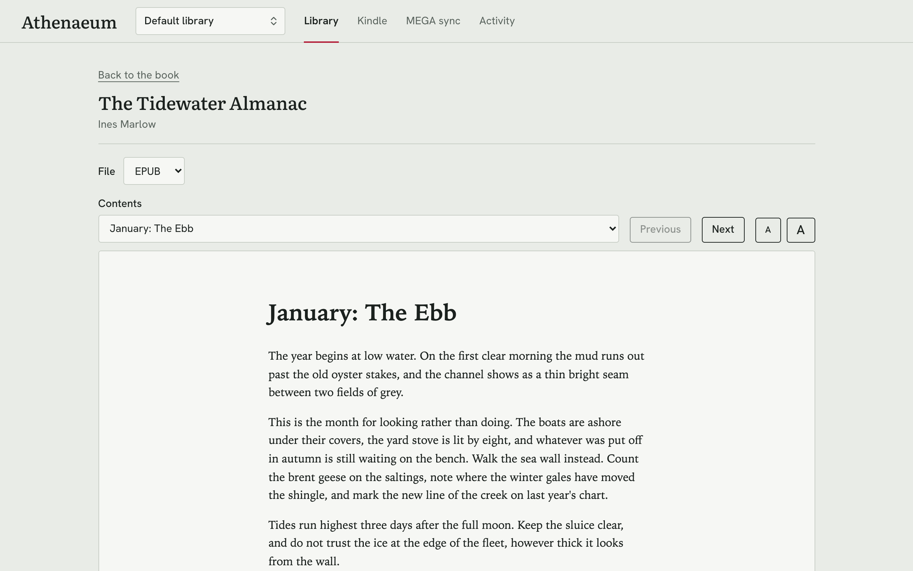
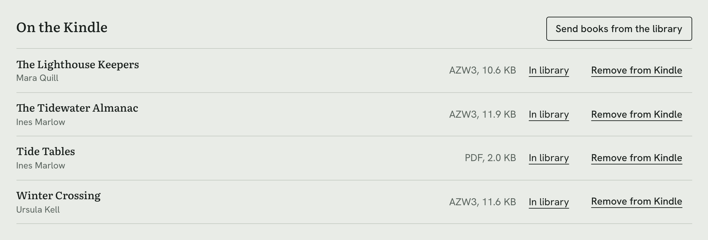
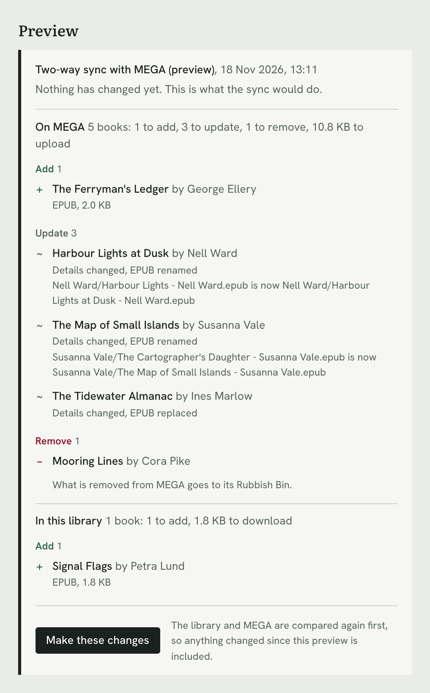

# Athenaeum

A self-hosted ebook library for one person: import your books, fix their
details, read them in the browser, convert them between formats, manage
what is on your Kindle and keep a copy of everything in a MEGA folder.



It is one Go binary that serves a JSON API and the React interface
embedded in it. The screenshots show a made-up sample library.

- [What it does](#what-it-does)
- [Get started](#get-started)
- [How it works](#how-it-works)
- [API](#api)
- [Development](#development)

## What it does

### Keeps your books in one browsable library

Upload or drag in EPUB, MOBI, AZW3, PDF and more; title, author, cover
and the other details are read from the file where it carries them.
Browse the shelf as a grid of covers or as a sortable list, search it,
and narrow it by category, language and format.



Categories are paths such as `History / Military`, so a category opens
to the ones below it. Many books can be filed at once.

### Lets you fix a book's details and files

Every field and the cover are editable, and the files on disk are
renamed to match. A book holds one file per format; convert between
them from its page. EPUB to AZW3 and back, and PDF to EPUB or AZW3, are
built in; with calibre installed, many more.



### Opens books in the browser

Click the cover on a book's page to read it. EPUB opens section by
section with its table of contents; PDF and TXT open as they are;
Kindle formats are unpacked first.



### Manages a Kindle

With the Kindle plugged in as a USB drive, see what is on it, remove
books, copy device books into the library and send library books. A
book with no Kindle format is converted to AZW3 on the way.



### Keeps a copy on MEGA

Sign in to MEGA in the app and sync the library with a folder there:
both ways, upload only or download only. A preview says, book by book,
what would be added, updated and removed on each side before anything
changes.



## Get started

```sh
go run ./...          # http://localhost:8080, data in ./data
```

or with Docker, which also brings calibre:

```sh
task docker:build
docker run --rm --name athenaeum -p 8080:8080 \
  -v athenaeum-data:/data \
  -v /Volumes/Kindle:/kindle \
  athenaeum:latest
```

or as a macOS app, in a window of its own instead of a browser tab:

```sh
task macos:app        # builds bin/Athenaeum.app
open bin/Athenaeum.app
```

The app keeps its library in `~/Library/Application Support/Athenaeum`;
see [macOS app](#macos-app).

There is no sign-in: the app is meant for one person on a trusted network.

### Configuration

Everything is set through environment variables.

| Variable | Default | Meaning |
| --- | --- | --- |
| `ATHENAEUM_ADDR` | `:8080` | Listen address. |
| `ATHENAEUM_DATA_DIR` | `data` | Holds `athenaeum.db`, the `library/` folder and `cache/`, which is safe to delete. |
| `ATHENAEUM_KINDLE_PATH` | detect | Kindle mount point. Also editable in the interface. |
| `ATHENAEUM_MEGA_FOLDER` | none | MEGA folder to sync with. Also editable in the interface. |
| `ATHENAEUM_SECRET` | none | Passphrase protecting the MEGA session kept in the database. Without it, the key is the file `secret.key` in the data folder. |
| `ATHENAEUM_EBOOK_CONVERT` | `ebook-convert` | calibre's converter. |
| `ATHENAEUM_EBOOK_META` | `ebook-meta` | calibre's metadata tool. |
| `ATHENAEUM_CONVERTER` | `native` | `calibre` hands calibre the conversions the built in converters would do, when it is installed. |
| `ATHENAEUM_STOP_ON_STDIN_CLOSE` | off | `1` stops the server once its standard input closes. The macOS app sets it so the server never outlives the app. |

## How it works

### Importing and editing

- Upload or drag in EPUB, MOBI, AZW3, PDF and more.
- Title, authors, series, publisher, ISBN, tags and cover are read from EPUB and
  MOBI/AZW files; title, author and keywords from PDF.
- Anything else falls back to a `Title - Author.ext` file name.
- Every field and the cover are editable. Folders and files are renamed to
  match.
- The publication date is a year, a year and month or a full day, entered as a
  typed year, a month chosen by name and a day; it is kept as `2019`, `2019-03`
  or `2019-03-12`, and dates in imported files are brought to that form.

### Browsing and categories

- Books are filed under categories, which are the book's tags written as a path
  such as `History / Military`.
- The library page lists the top-level categories, the ones with the most books
  first and ten at most before a "show more"; each opens to the categories below
  it, by itself when it is ticked, and ticking one also shows the books below
  it.
- Categories, language and format are tick boxes with the number of books each
  leads to: ticking several values of one kind shows the books with any of them,
  the kinds combine, and a value that leads nowhere is dimmed.
- The choice is kept in the address of the page.
- The shelf shows as a grid of covers or as a list with title, author,
  publication date, publisher, categories and files, which the headings of its
  columns sort.
- The shelf is sorted by one property in one direction: "Sort by" and the
  headings of the list name the same properties and change the same order, and
  dates start with the newest.
- The library page uses the whole width of the window; a wide list also shows
  the language and the day each book was added.
- A book takes up to three categories, the most specific ones: filing it under
  `History / Military` takes it out of `History`.
- A book's page offers the categories already in use and a field for a new
  one.
- On the library page many books are filed, or taken out of a category, at once.
- A page lists every category to rename it, merge it into another or remove it.
- Subjects embedded in imported files are kept as they are and can be tidied
  there.

### Library folder

Books live in `library/` inside the data folder, one folder per first
author, with the files of a book side by side:

```
library/
  Ursula K. Le Guin/
    The Dispossessed - Ursula K. Le Guin.epub
    The Dispossessed - Ursula K. Le Guin.azw3
  _athenaeum/
    <id>.json    details of one book and the list of its files
    <id>.jpg     its cover
```

- A second book with the same title and author gets ` (2)` in its name.
- The folder is read on start-up, after every download from MEGA and on
  `POST /api/library/rescan`.
- An ebook found anywhere in the folder that belongs to no book becomes
  one: its details are read from the file, files that share a folder and
  a name become formats of one book, and the files are moved under the
  author. Other files are left where they are.
- A book whose files are all gone is dropped from the database. Its
  details file stays in `_athenaeum/`.
- Folders written by earlier versions (`Author/Title (id)/metadata.json`)
  are converted in place and keep their identity.

### Conversion

Three conversions are built in and need nothing installed: EPUB to AZW3
and back, and PDF to EPUB. With calibre installed, any format its
`ebook-convert` can read converts to AZW3, DOCX, EPUB, FB2, HTMLZ, MOBI,
PDF, RTF or TXT. Either way the result lands in the book's file list
with the library details and cover written into it.

**EPUB to AZW3.** Every chapter is kept as it is and repackaged as KF8,
the format inside AZW3 files: links between chapters, footnote jumps,
the nested table of contents, stylesheets and JPEG, PNG and GIF images
all carry over, and the cover and a thumbnail are embedded. Left out,
and reported as warnings on the job: embedded fonts (the Kindle uses its
own), scripts, and images in formats a Kindle cannot show, which are
replaced by their alternative text. EPUB files protected by DRM and
chapters that are not well formed XHTML are refused.

**AZW3 to EPUB.** The reverse: the chapters are put back together from
their pieces, position links become ordinary links again, and images,
stylesheets and embedded fonts are written out as files. It reads any
KF8 book, which is every AZW3 and the MOBI files that carry KF8 next to
the older format. Not read: books protected by DRM, books compressed
with Huffman coding, and files that only hold the older MOBI format;
with calibre installed the last two are handed to it.

**PDF to EPUB.** A PDF stores positioned letters, not paragraphs, so
the text is rebuilt: letters into words and lines, lines into paragraphs
in reading order (two columns included), headings from type size and
weight, bold and italic runs, images, and sections from the PDF's
bookmarks or, without them, from its headings. Running headers, footers
and page numbers are removed and words hyphenated at line ends are
joined. The result is a guess that suits books made of prose. Known
weak spots: tables and definition lists come out as loose lines,
footnotes stay where they sat at the foot of the page unlinked, vector
drawings are dropped, and right-to-left text is not reordered. What is
left out is listed as warnings on the job. Refused: encrypted PDFs, and
PDFs without readable text, which are scans (there is no OCR) or use
fonts that do not say which characters they hold.

**PDF to AZW3** runs the two in a row.

The AZW3 files follow the layout calibre writes, down to the per-record
indexing data, and are checked against calibre's own MOBI inspector
(`calibre-debug --inspect-mobi`). The reader is tested on files calibre
wrote, kept in `internal/azw3/testdata`. The format references were the
[MobileRead wiki](https://wiki.mobileread.com/wiki/KF8), calibre's
source and [leotaku/mobi](https://github.com/leotaku/mobi).

### Reading

Click the cover on a book's page to read it in the browser. EPUB opens section
by section with its table of contents; PDF and TXT open as they are. Kindle
books in KF8 (every AZW3, and the MOBI files that carry it) are unpacked to
EPUB first by the application itself; older MOBI files and every other format
need calibre for that. The result is kept in `cache/preview/` and never added
to the library.

### Kindle

The Kindle must be mounted as a USB drive. Without a configured path the
app looks in `/Volumes/Kindle`, `/kindle`, `/mnt/kindle`, `/media/Kindle`,
`/media/*/Kindle` and `/run/media/*/Kindle`. In Docker, plug the Kindle in
first, then start the container with the drive mounted at `/kindle`.

The supported formats (AZW3, MOBI, AZW, PRC, PDF, TXT, AZW4, KFX, AZW1,
TPZ, POBI), the `documents` folder and the sidecar files removed with a
book (`.sdr` folder, `.mbp`, `.apnx` and friends) follow the `KINDLE2`
driver in calibre's
[`devices/kindle/driver.py`](https://github.com/kovidgoyal/calibre/blob/master/src/calibre/devices/kindle/driver.py).

A book sent without a Kindle format is converted to AZW3 first, which
needs no calibre for EPUB and PDF books.

### MEGA sync

Sign in on the sync page with the email and password of the MEGA
account, and the two-factor code if the account has one.

- The password goes to MEGA once and is never stored.
- What is kept is the session MEGA answers with (a session ID and the
  account's master key), sealed with AES-256-GCM in the `secrets` table
  of the database.
- The key is not in the database. With `ATHENAEUM_SECRET` set it is
  derived from that passphrase; otherwise it is the file `secret.key`
  in the data folder, readable by its owner only. A copy of the
  database alone cannot open the session; a copy of the whole data
  folder can, unless the passphrase is used.
- Signing out forgets the session and ends it on MEGA. A session MEGA
  has ended elsewhere is forgotten at the next sync, which asks to sign
  in again.
- The interface has no login of its own and sends the password over
  whatever connection it is served on, so put it behind HTTPS when it
  is not on your own machine.

The whole `library/` folder is synced, `_athenaeum/` included, so a
download followed by the automatic rescan rebuilds the database from MEGA
alone.

Files deleted, renamed or moved here are remembered, with the book they
belonged to, until the next upload removes their old copies from MEGA. A
download in between does not bring them back. Folders left empty on MEGA
are not removed.

A sync reports books, not files. A book whose title or author changed is
one update, with its file renamed, rather than a deletion and an upload;
a deleted book is one removal. Files that belong to no book are listed
apart. A preview of a download names the books MEGA has from their
details files, reading up to 30 of them; past that, books are named
after their files.

| Action | Effect |
| --- | --- |
| Sync both ways | Removes from MEGA what was deleted here, uploads, then downloads. Books deleted directly on MEGA come back on the next upload. |
| Upload to MEGA | MEGA catches up with the library. With the delete option, MEGA becomes an exact mirror. |
| Download from MEGA | The library catches up with MEGA. With the delete option, the library becomes an exact mirror. |

Deletions on MEGA go to its Rubbish Bin; deletions in the library are
permanent.

Every upload and download is planned first, which gives the number of
changes and their size. Progress then advances as each change starts,
per file, not within a file.

### macOS app

`task macos:app` builds `bin/Athenaeum.app`: a small Swift program that
shows the web interface in a `WKWebView` window and runs the server,
unchanged, as a child process.

- The server listens on `127.0.0.1`, on a free port picked at launch, so
  only this Mac can reach it.
- The library lives in `~/Library/Application Support/Athenaeum`, and
  the server's output goes to `~/Library/Logs/Athenaeum/server.log`.
- calibre is used from `/Applications/calibre.app` when it is installed,
  and the Kindle is found at `/Volumes/Kindle` as usual.
- Quitting the app or closing its window stops the server. So does the
  app being killed.
- Downloads ask where to save the file. Links that leave the app, and
  "open in a new tab", go to the default browser.
- The app is built for the architecture of the Mac that builds it and is
  signed ad hoc, so it runs on that Mac but is not ready to hand to
  someone else. Building it needs `swiftc`, which comes with Xcode.

### External tools

The Go standard library covers the server, the EPUB/MOBI/PDF metadata
parsers, the Kindle file handling and the built in converters. Three
things are delegated:

- **SQLite**: `modernc.org/sqlite`, a pure Go driver, so the binary stays
  static and builds without a C toolchain.
- **calibre**: `ebook-convert` does the conversions the built in
  converters do not cover and prepares previews of Kindle formats;
  `ebook-meta` writes details into files sent to the Kindle and extracts
  covers the built-in parsers cannot. Without calibre everything else
  still works and the interface only offers the built in conversions.
- **[mega-cli](https://github.com/manzanit0/mega-cli)**: its Go packages
  sign in to MEGA and do the transfers. They are compiled in, so no
  `mega` program needs to be installed.

## API

The interface uses nothing but this API. Errors are
`{"error": "message"}`. Long operations return `202` with a job to poll.

| Method and path | Purpose |
| --- | --- |
| `GET /api/health` | Liveness check. |
| `GET /api/system` | Version, supported formats, whether calibre is available (`can_convert`) and what converts without it (`native_conversions`). |
| `GET /api/settings`, `PUT /api/settings` | `mega_folder` and `kindle_path`. |
| `GET /api/books?q=&sort=&order=` | List and search. `sort` is `title`, `author`, `published`, `publisher`, `language`, `added` or `updated`, with `order=desc` to reverse it; books without the property come last either way. Narrow with `tag` (a category, which also matches the categories below it), `language` (`en` also matches `en-US`) and `format`, each of which may be repeated to accept any of several values, with `untagged=true` to let in books without tags and with `author`. |
| `POST /api/books` | Multipart upload; one book per file. |
| `GET /api/books/{id}` | One book. |
| `PATCH /api/books/{id}` | Update the metadata fields present in the body. `published` must be `2019`, `2019-03` or `2019-03-12`; anything else is answered with `400`. |
| `DELETE /api/books/{id}` | Delete the book and its files. |
| `GET`, `PUT`, `DELETE /api/books/{id}/cover` | Cover image; `PUT` takes the raw image as the body. |
| `POST /api/books/{id}/formats` | Multipart upload of an additional format. |
| `GET`, `DELETE /api/books/{id}/formats/{format}` | Download or remove one file. |
| `POST /api/books/{id}/convert` | `{"to": "azw3", "from": "epub"}`; `from` is optional. Returns a job whose result holds the `book`, the `engine` used (`native` or `calibre`) and `warnings` listing what was left out. |
| `GET /api/books/{id}/preview?format=` | How to show the book: `kind` (`epub`, `pdf` or `text`), the `base` address of its content and, for EPUB, the `sections` in reading order and the `contents`. `format` is optional. Answers `202` with a job when the book must be converted first; ask again when the job is done. |
| `GET /api/books/{id}/preview/{format}/{path}` | The content: the PDF or TXT file itself, or the file at `path` inside the EPUB. Section and contents `href`s are relative to `base`. |
| `GET /api/books/facets` | Takes the parameters of `GET /api/books` and counts what the listing can be narrowed by: `tags`, `languages` and `formats`, each an alphabetical list of every `value` in the library with its `count`, plus `untagged`, `matching` and the `total` of the library. The counts of one kind leave the narrowing by that kind out. A category with others below it is listed with the count of all the books below it. |
| `POST /api/books/tags` | `{"ids": [1, 2], "add": ["History / Military"], "remove": []}`; files several books under categories, or takes them out, and returns them. |
| `POST /api/books/tags/rename` | `{"from": "History", "to": "Past"}`; renames a category and those below it on every book and returns how many `books` changed. Naming an existing category merges the two; an empty `to` removes the category. |
| `POST /api/library/rescan` | Rebuild the database from the library folder and file loose ebooks. |
| `GET /api/jobs`, `GET /api/jobs/{id}` | Job history and status. A running sync carries `progress`: its `phase` (`preparing`, `uploading`, `downloading` or `finishing`), `done` and `total` changes, `bytes_done` and `bytes_total`, and the `current` path. |
| `GET /api/device` | Kindle status and free space. |
| `GET /api/device/books` | Books on the Kindle. |
| `POST /api/device/books` | `{"book_id": 1, "format": "azw3"}`; `format` is optional. Returns a job. |
| `DELETE /api/device/books?path=` | Remove a book from the Kindle. |
| `POST /api/device/import` | `{"path": "documents/x.mobi"}`; copy a Kindle book into the library. |
| `GET /api/sync` | Whether a MEGA account is `signed_in`, its `account`, the folder and the last run. |
| `POST /api/sync/session` | `{"email": "", "password": "", "code": ""}`; signs in to MEGA. `401` with `code_required` when the account needs a two-factor code. |
| `DELETE /api/sync/session` | Signs out; `confirmed` says whether MEGA confirmed the end of the session. |
| `POST /api/sync` | `{"direction": "both", "delete": false, "dry_run": false}`. Returns a job. The result describes each side that takes part, `mega` and `library`, book by book: `books` with their `kind` (`add`, `update` or `remove`), `title`, `authors`, whether the `details` change, how the `cover` changes and what happens to the `files` (`add`, `replace`, `remove`, or `rename` with `from`), and the `other` files that belong to no book. A dry run plans the same without changing anything. The raw file `actions` per direction, with the `files` and `bytes` transferred, are under `push` and `pull`. |

## Development

```sh
task            # list tasks
task test       # Go tests
task e2e        # Playwright journeys, driven through installed Chrome
task web        # rebuild web/dist with the local npm
task web:docker # rebuild web/dist inside Docker instead
task dev        # Vite dev server proxying /api to :8080
task macos:run  # build bin/Athenaeum.app and open it
```

`web/dist` is committed because `go:embed` needs it at compile time;
rebuild it after changing anything under `web/src`.

The Go and Playwright tests run the real server against stand-ins: an
`ebook-convert` in `testdata/` that copies its input, and
`internal/megasync/megatest`, a MEGA whose cloud drive is a local folder
and which plans syncs with the real rules. The Playwright server is built
with the `fakemega` tag to include it; ordinary builds cannot reach it.

`task docker:watch` runs the app in Docker on port 9000 with the local
`./data` folder, and rebuilds and replaces the container whenever the
code changes; see `compose.yaml`.

### Layout

```
main.go              wiring and configuration
internal/api         HTTP handlers, background jobs
internal/library     author folders on disk, rescan, adoption of loose files
internal/meta        EPUB, MOBI and PDF metadata parsers
internal/store       SQLite index, settings, job history
internal/convert     picks the built in converter or calibre
internal/azw3        EPUB to AZW3 converter and back
internal/kf8         KF8 (AZW3) file writer and reader
internal/epub        EPUB writer
internal/reflow      PDF to EPUB converter
internal/pdf         PDF reader
internal/preview     EPUB reading order, contents and files for the reader
internal/device      Kindle storage
internal/megasync    MEGA sign-in and sync logic over mega-cli's packages
internal/vault       secrets encrypted in the database
web/                 React, TypeScript and Tailwind interface
macos/               Swift shell, Info.plist and icon of the macOS app
e2e/                 Playwright tests
```
