# De-cluttering the library, book, Kindle and sync pages

Built. This is what was implemented. The pictures are the mock-ups it
was built from, made by editing the earlier pages with a made-up sample
library; the pages themselves differ from them in small ways.

## Summary

Four pages change. The Activity page only gains the version.

| Page | Controls today | After |
| --- | --- | --- |
| Library, before the first book | 37 | 25 |
| Book, whole page | 30 | 8 |
| Kindle, whole page | 36 | 11 |
| MEGA sync, whole page | 17 | 12 |

- **Library**: the filter panel becomes a list of shelves, the toolbar
  shrinks to one row, and books are selected by ticking them.
- **Book**: the page opens as a description of the book; the form is
  one press away.
- **Kindle**: the page shows the device; books are sent from the
  library.
- **MEGA sync**: one "Sync" button that always shows what it would
  change first; the rest is one press away.

The library figure counts what is visible in the first screen, top bar
included. The others count the whole page below the top bar, since
those pages scroll. On the sync page 9 of the controls, before and
after, are links in the report of the last sync.

## The library page

The page shows 37 controls before the first book, and books fill 47% of
the first screen. After this change it shows 25, and books fill 61%.

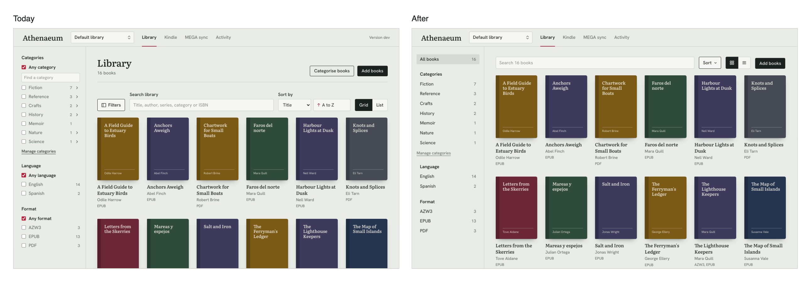

What changes:

1. **The page title and the search label go.** The tab already says
   "Library"; the search field says "Search 16 books".
2. **The filter panel becomes a list of shelves.** One row per
   category, language and format, with its count. No tick boxes, no
   arrows, no "Any" rows.
3. **The panel is always shown.** The "Filters" button goes.
4. **Sorting folds into one "Sort" menu.** Field and order together.
5. **Grid and List become two icons.**
6. **"Categorise books" goes.** A tick box appears on a book under the
   pointer; ticking one brings up a bar with the actions.
7. **The version leaves the top bar** for the Activity page.

Measured in a 1280 by 800 window on the sample library of 16 books.
"Controls" counts every visible link, button, field and tick box that is
not a book. "Books" is the share of the window taken by the shelf.

| | Controls | In the panel | Books |
| --- | --- | --- | --- |
| Today | 37 | 23 | 47% |
| After | 25 | 14 | 61% |
| After, Fiction chosen | 29 | 18 | 58% |

### The page, piece by piece

#### Top bar

Unchanged, except that the version is no longer in it.

#### Toolbar

One row, left to right:

| Control | Today | After |
| --- | --- | --- |
| Filters button | Shows and hides the panel. | Gone. |
| Search | Field under a "Search library" label. | Field alone, reading "Search 16 books". The label stays for screen readers. |
| Sort | A field list and an order button. | One "Sort" button that opens a menu. |
| Layout | "Grid" and "List" buttons. | Two icons, named "Grid" and "List" for screen readers and under the pointer. |
| Categorise books | Button above the toolbar. | Gone; see "Select books and act on them". |
| Add books | Button above the toolbar. | Last in the toolbar, still the one filled button. |

Dropping files anywhere on the page still adds them.

#### Shelves panel

Always beside the books. From the top:

- **All books**, with the size of the library. Chosen when nothing
  narrows the shelf. Pressing it clears every choice below.
- **Categories.** One row per top-level category, with its count.
- **Language** and **Format.** One row per value, with its count. As
  today, each appears only when the library has more than one.
- **Manage categories**, under the categories, as today.

Kept from today: counts follow the search and the other choices; a row
with nothing left is faint and cannot be pressed; "Without a category"
appears when some books have none; past ten top-level categories the
rest sit behind "Show N more categories".

#### Books

The grid and the list look as they do today. The list keeps its
columns and its sorting by column heading.

### Workflows

#### Browse a shelf

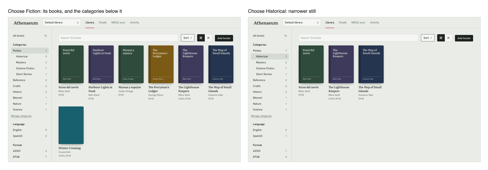

1. Press a category. The shelf shows its books, the row is highlighted
   and the categories below it open.
2. Press one below it. The shelf narrows to that one; the highlight
   moves to it and the parent stays open.
3. Press "All books" to see everything again.

Rules:

- One choice of each kind at a time: one category, one language, one
  format. Choices of different kinds combine, as today: Fiction, in
  Spanish, as EPUB.
- Pressing another row of the same kind moves the choice to it.
- The highlighted row is the only sign of what is chosen. The "Showing
  only" strip above the books goes, with one exception below.

#### Search

Unchanged. Typing narrows the shelf as today, within the chosen
shelves, and the counts in the panel follow.

#### Sort and change layout

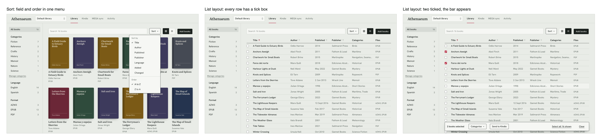

- **Sort** opens one menu with two groups. "Sort by" lists today's
  seven fields. "Order" offers "A to Z" and "Z to A", or "Newest first"
  and "Oldest first" for dates, as today. A tick marks what is in use.
- **Layout** is two icons; the one in use is filled. The choice is
  remembered, as today.
- In the list, column headings still sort. The Sort menu stays, since
  it reaches fields that have no column at every width.

#### Select books and act on them

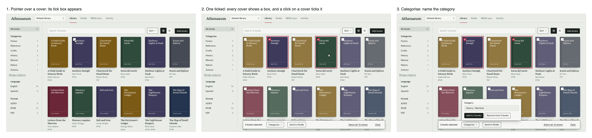

There is no button to start selecting and no separate mode.

1. **Grid, nothing ticked.** A tick box appears on a cover while the
   pointer is over it, or while it has keyboard focus. A click on the
   cover opens the book, as today. Books stay links.
2. **Tick one.** Every cover now shows its tick box, and a click
   anywhere on a cover ticks or unticks it. A bar appears at the bottom
   of the window.
3. **Act.** The bar offers:
   - **Categorise**, which opens the category field, with the library's
     categories as suggestions, and "Add to N books" and "Remove from N
     books".
   - **Send to Kindle**, which sends each ticked book as the book page
     does today.
   - **Select all N shown**, which becomes "Select none" when all are
     ticked.
   - **Clear**, which unticks everything.
4. **Nothing ticked again.** The bar goes, the boxes go and a click
   opens a book again.

In the list, and on touch screens in either layout, the tick boxes are
always shown, since there is no pointer to bring them up. The bar works
the same.

#### Add books

Unchanged, apart from where the button sits.

### What goes, and where it went

| Gone | Instead |
| --- | --- |
| "Library" title and "16 books" under it | The tab, and "Search 16 books" in the search field. |
| "Search library" label | Nothing visible; kept for screen readers. |
| "Filters" button | Nothing; the panel is always shown. |
| "Any category", "Any language", "Any format" | "All books". |
| Tick boxes and arrows in the panel | The row itself. |
| "Showing only" strip and "Show everything" | The highlighted rows, and "All books". |
| "Sort by" list and order button | The "Sort" menu. |
| "Grid" and "List" in words | Two icons. |
| "Categorise books" and its "Done" | Tick boxes on the books and the bar. |
| Version in the top bar | The Activity page. |

## The book page

Today the page is a form: every detail of the book is an open field,
with the cover, file and delete controls beside it. It has 30 controls
and is two screens tall. After, it opens as a description of the book
with 8 controls, in one screen.

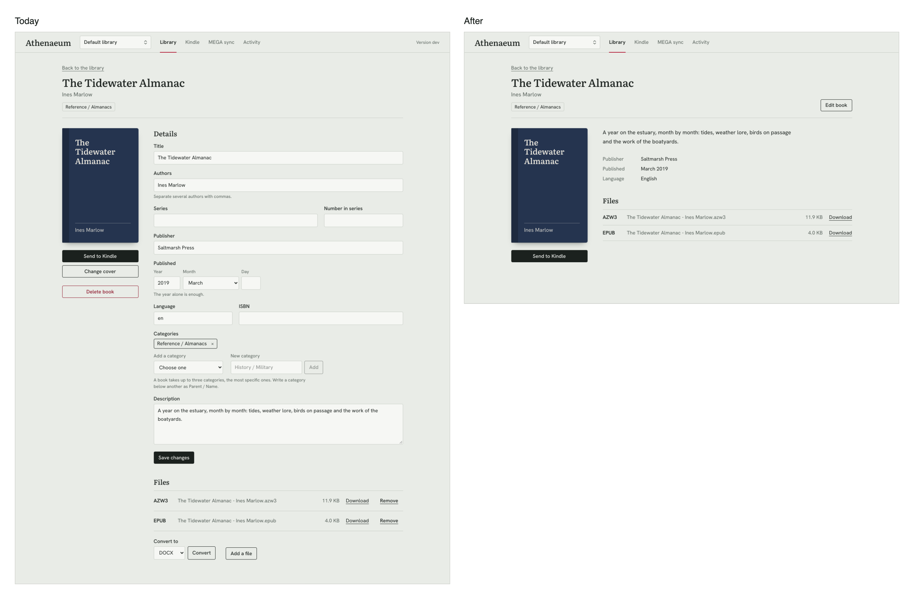

### The page, piece by piece

| Part | Today | After |
| --- | --- | --- |
| Heading | Title, authors and categories, each author and category a link to its books. | The same, plus an "Edit book" button. |
| Cover | Opens the book for reading. | The same. |
| Send to Kindle | Under the cover; off, with the reason, when no Kindle is connected. | The same. |
| Details | Eleven open fields and "Save changes". | Read as text: the description, then series, publisher, date, language and ISBN, each only when filled. |
| Categories | A picker in the form. | The links in the heading; the picker is in the edit view. |
| Files | Each with "Download" and "Remove"; "Convert to" and "Add a file" below. | Each with "Download". The rest is in the edit view. |
| Change cover, Remove cover | Under the cover. | In the edit view. |
| Delete book | Under the cover. | In the edit view. |

### Workflows

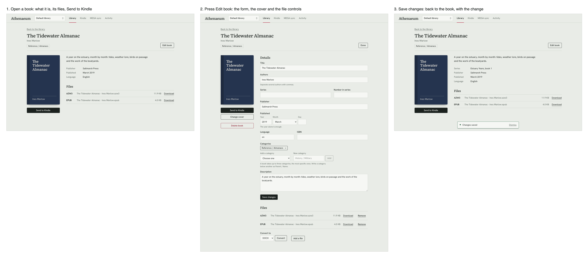

#### Look at a book

Open it from the shelf. The page says what the book is and offers what
a reader does with it: read it, by pressing the cover; send it to the
Kindle; download a file; go to its author or category.

#### Change a book

1. Press "Edit book". The page becomes today's page: the form, the
   cover controls, the file controls and "Delete book". The button
   reads "Done".
2. Change the details and press "Save changes". The page returns to
   the book, showing the change, and says "Changes saved".
3. Cover and file actions take effect at once, as today, and leave the
   edit view open. "Done" returns to the book.

#### Delete a book

"Edit book", then "Delete book", then the confirmation, as today.

## The Kindle page

Today the page lists the device's books and, below, the library's
books again with a button each, so that they can be sent. With 16
books it has 36 controls; the count grows with the library. After, the
page shows the device only, with 11, and sending starts from the
library.

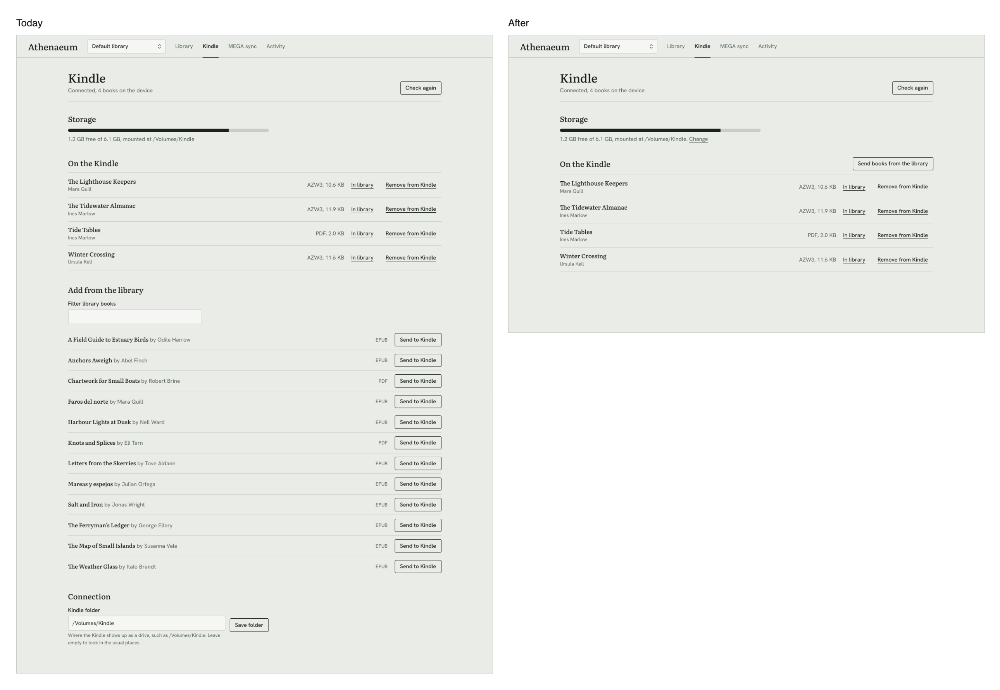

### The page, piece by piece

| Part | Today | After |
| --- | --- | --- |
| Heading | "Connected, N books on the device" and "Check again". | The same. |
| Storage | A bar, the space left and where the Kindle is mounted. | The same, with "Change" after the path. |
| On the Kindle | Each book with "In library" or "Copy to library", and "Remove from Kindle". | The same, with a "Send books from the library" button beside the title. |
| Add from the library | A filter field and every library book not on the Kindle, each with "Send to Kindle". | Gone; see "Send books to the Kindle". |
| Connection | The "Kindle folder" field and "Save folder", at the foot. | Behind "Change". |
| No Kindle found | A message and the "Kindle folder" field. | The same. |

### Workflows

#### Send books to the Kindle

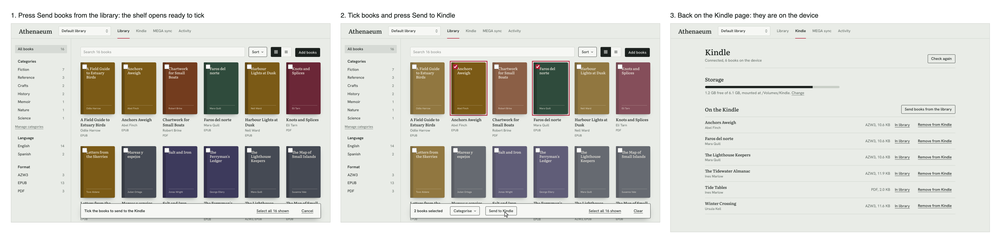

1. On the Kindle page, press "Send books from the library". The
   library opens with a tick box on every book and a bar that says
   "Tick the books to send to the Kindle".
2. Tick the books and press "Send to Kindle" in the bar.
3. The Kindle page returns, and the books are in its list.

The same bar appears on any visit to the library once a book is ticked,
so books can also be sent without starting from the Kindle page. One
book can still be sent from its own page.

#### Remove a book, or copy one to the library

Unchanged: "Remove from Kindle" asks first; "Copy to library" appears
for a book the library does not have.

#### Say where the Kindle is

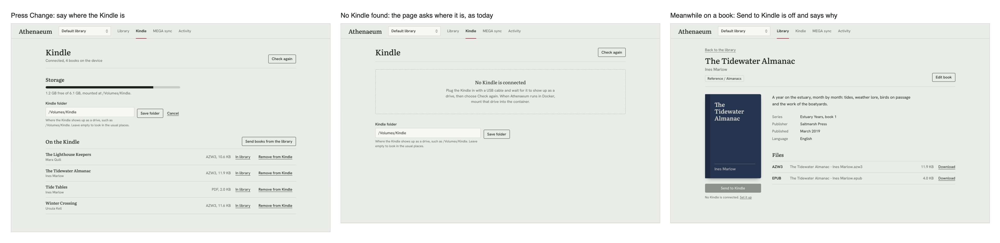

- With a Kindle found, press "Change" beside the path. The "Kindle
  folder" field opens in place, with "Save folder" and "Cancel".
- With none found, the page shows the message and the field at once,
  as today: that is when the field is needed.
- Meanwhile "Send to Kindle" is off on a book's page and in the
  selection bar, and says why.

## The MEGA sync page

Before, the page held the account, the folder, two tick boxes and three
sync buttons at once: 8 controls besides the report of the last sync.
After, it holds 3: "Change", "Sync" and "More options". The pictures in
this section are of the built page.

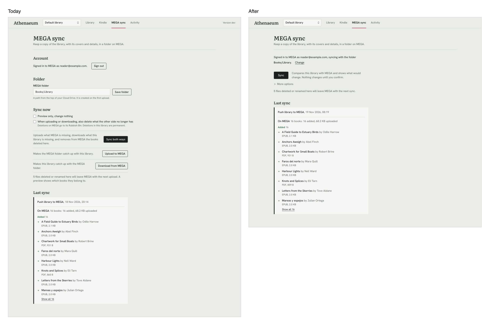

### The page, piece by piece

| Part | Before | After |
| --- | --- | --- |
| Account | "Signed in as" with "Sign out", or the sign-in form. | Part of one sentence once an account and a folder are set; "Change" brings both back. |
| Folder | A field and "Save folder". | The same sentence. |
| "Preview only, change nothing" | A tick box. | Gone: every sync previews. |
| "Sync both ways" | A button that synced at once, unless the tick box was set. | "Sync", which shows the preview. |
| "Upload to MEGA", "Download from MEGA" | Two more buttons. | Under "More options". |
| "Also delete what the other side no longer has" | A tick box. | Under "More options". |
| Preview and last sync | A report below. | The same. |

### Workflows

#### Sync

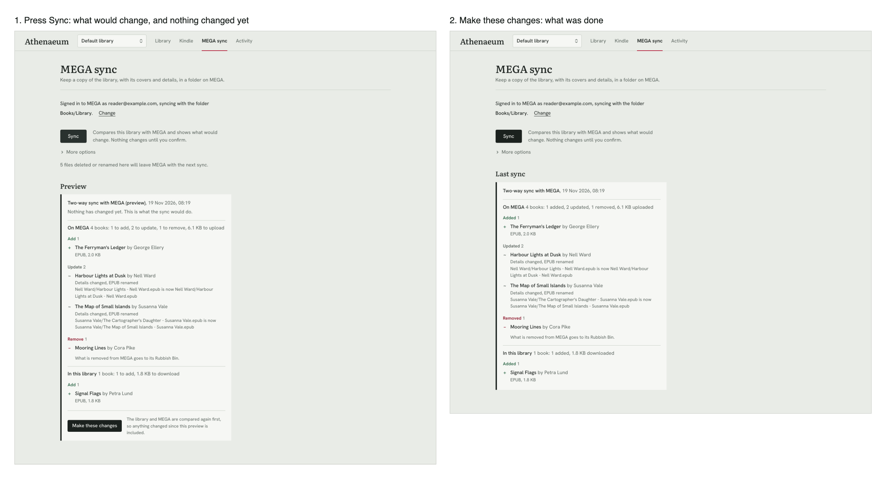

1. Press "Sync". The library and MEGA are compared, and the page shows
   what would change on each side, book by book. Nothing has changed.
2. Press "Make these changes". Both sides are compared again and the
   changes are made, with a progress bar. The page then shows what was
   done.

When both sides already match, the preview says so and offers nothing
to confirm.

#### Sync one way, set up, sign out

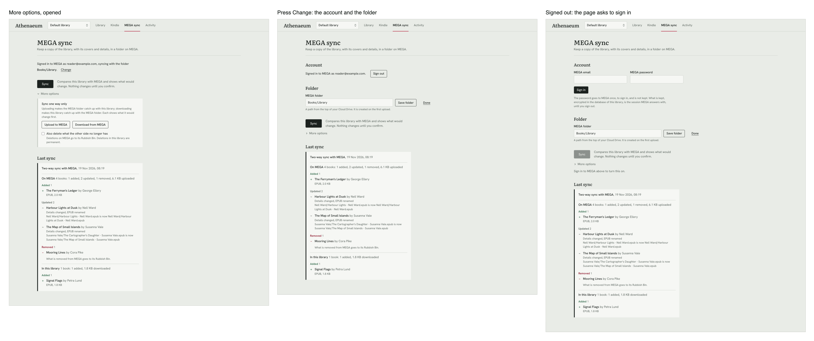

- **One way only.** "More options" holds "Upload to MEGA", "Download
  from MEGA" and the option to also delete what the other side no
  longer has. Each shows its preview first, like "Sync".
- **Change the account or the folder.** "Change" opens both, as they
  were before; "Done", or saving the folder, puts them away.
- **Not set up yet.** Until an account is signed in and a folder is
  saved, both are shown in full and "Sync" is switched off, with a
  line that says what is missing.

## Costs accepted

- **No combining within a kind.** Today, ticking Fiction and History
  shows the books in either. After, it is one or the other. Whether
  anyone combines them is not known: nobody was observed.
- **The panel cannot be put away.** Books fill 61% of the screen, not
  the 76% they could with it hidden. Apple's guidance is to let people
  hide a sidebar [15]; this drops that.
- **Icons without words.** Icons need a visible text label, and few are
  understood by everyone [9]. Whether these two are among the few was
  not checked.
- **Tick boxes are out of sight until the pointer finds them** in the
  grid. What is out of sight is used less and found later [5]. The list
  shows them always.
- **Editing a book takes one more press.** That editing is the rarer
  visit is an assumption: nobody was observed. Rarely used options are
  the ones to defer [3].
- **The Kindle page no longer lists what is not yet on the Kindle.**
  The library does not mark which books are already on it either.
- **Sending starts on another page**, which is less visible than a
  list on the Kindle page itself [5].
- **Every sync takes two presses.** In return nothing changes on
  either side without having been shown first. People who only ever
  upload have one more press, to open "More options".

## How the open details were settled

Each was built with the default proposed for it, except where noted.

1. **Narrow windows.** Below 48rem the shelves are put away behind a
   "Filters" button and open between the toolbar and the books, as
   before. There the "Showing only" strip lists everything the shelf is
   narrowed to, since the shelves are out of sight.
2. **An author as a filter.** The "Showing only" strip stays for an
   author, at any width.
3. **How many matched.** A line above the books, such as "2 of 16
   books", shows while a search or an author narrows the shelf.
4. **Pressing the chosen row again.** It lets go of it. Differs from
   the default for a category below another: that gives back the
   category above it, not the whole library.
5. **"Find a category".** Shown only when the list is cut by "Show N
   more categories".
6. **No Kindle connected.** "Send to Kindle" in the bar is switched off
   and says why, with a link to the Kindle page.
7. **Leaving a selection.** Escape clears it, like "Clear".
8. **Ticked books that leave the shelf.** Only ticked books that are
   shown count.
9. **Leaving the edit view.** "Save changes" saves and returns to the
   book. "Done" returns without saving, and asks first when details
   were changed. The edit view has its own address, so the browser's
   Back button also leaves it, without asking.
10. **"Convert to" and "Add a file".** In the edit view.
11. **Empty details.** Left out of the book's description.
12. **Arriving from the Kindle page.** The library opens with the tick
    boxes shown and the bar saying what to do; "Send to Kindle" and
    "Cancel" both return to the Kindle page.
13. **Books already on the Kindle.** Skipped, and the notice says how
    many were sent and how many skipped.
14. **A Kindle with no books.** Its message points to "Send books from
    the library".

Also settled while building:

- An empty library shows "Add books" alone, without search, "Sort" or
  the layout icons.
- In the list, a click on a title always opens the book, also while
  books are ticked. Only covers in the grid turn into tick targets.
- "Send to Kindle" stays in the edit view of a book as well.
- The Activity page shows the version under the list.
- On the sync page, the option to delete what the other side no longer
  has applies to one-way syncs only, as it did before.

## Considered and not chosen

| Idea | Why not | Picture |
| --- | --- | --- |
| Search that suggests categories, in place of the panel | Suggestions help only once part of a name is remembered [19]; the panel shows what exists. | [search](decluttering/search.png) |
| Sections as status marks in place of the tabs | Removes two controls, frees no space, and navigation that is less visible is used less [5]. | [status marks](decluttering/status-marks.png) |
| Tick boxes kept in the panel, arrows merged | Saves less; the list of shelves was preferred. | [variant](decluttering/library-chosen.png) |
| Grid and List inside a "View" menu | A second press to change layout, and the layout in use not shown. | [view menu](decluttering/view-menu.png) |
| A "Filters" button to hide the panel | The panel is to stay on. | [filters](decluttering/filters-button.png) |
| A "Select" button and a selecting mode | One button and one mode more than needed. | [select](decluttering/select-flow.png) |
| Tick boxes always shown on covers | 12 more controls in view, back to today's 37, and the box sits on the cover's title. | [always shown](decluttering/tick-boxes-always.png) |
| One click selects, two open | Slows the common action to speed the rare one; does not work on touch; books stop being links. A judgement from convention, not from the sources below. | none |

## What the research says

"Read" says how much of the source was checked: the full text, the
abstract only, or a report of it in another source.

| Source | Read | Finding | What it means here |
| --- | --- | --- | --- |
| Tuch et al. 2012 [1] | Abstract | Sites of low visual complexity and familiar layout were rated most appealing, within 50 ms. | Reduce complexity, but keep the layout conventional. |
| NN/g, heuristic 8 [2] | Full | Rarely needed information competes with what is needed. Minimalism also fails when it removes necessary elements. | Remove duplicates, not functions. |
| NN/g, progressive disclosure [3] | Full | Defer rarely used options; keep frequent ones up front; no more than two levels; label the way in clearly. | Sorting moves into one menu, one level deep. So does the category field in the bar. |
| NN/g, recognition and recall [19] | Full | Recognising is easier than recalling because there are more cues; a menu is the classic recognition interface, and search makes people produce terms from memory. | The panel answers "what categories do I have?", so it stays in sight. |
| Findlater and McGrenere 2007 [4] | Abstract | A reduced interface made features easier to find, but people were less aware of what was hidden. | What is put away is forgotten: a reason to keep the panel on. |
| NN/g, hidden navigation study [5] | Full | 179 participants. On desktop, hidden navigation was used in 27% of cases against 48% when visible, and tasks took at least 39% longer. | Keep the tabs and the panel visible. The study is of website navigation, so this is an extrapolation. |
| NN/g, flat interface study [6] | Full | 71 participants, eye tracking. Weak signifiers cost 22% more time and 25% more fixations. | Rows without tick boxes must still look pressable: a clear pointer-over and chosen state. |
| NN/g, placeholders [7] and search icon [8] | Full | Placeholders are a poor replacement for labels, least so for a search box. A search box needs no label if it is an open field. | Drop "Search library". Do not turn other labels into placeholders. |
| NN/g, icons [9] | Full | Icons need a visible text label; few are universally understood. | The layout icons go against this; see "Costs accepted". |
| NN/g, indicators [10] and heuristic 1 [11] | Full | Indicators are conditional and passive, and can be missed. Background work matters to people when it affects them. | Not used in this change. |
| Hearst 2009, chapter 8 [12] | Full for facets | Show facet values with counts, avoid empty results, keep keyword search and facets working together, and keep facets from growing too wide or deep. | Keep the counts; faint rows for empty ones; search narrows within the shelves. |
| Yee et al. 2003, as reported in [12] | Report | 32 participants. 91% preferred the faceted interface overall, but about half preferred plain search for a simple task, citing its simplicity. | Both paths stay: the panel for browsing, search for the quick case. |
| Baymard, autocomplete [13] | Most | Past about 10 suggestions people stop reading. Category suggestions help but are overlooked unless they look different. | Behind the rejection of search suggestions. |
| Baymard, filter toolbars [14] | Full | A filter toolbar hides the options and their counts; a filter sidebar is the proven form. | Keep the panel at the side. |
| Apple, sidebars [15] | Full | Let people hide a sidebar, but do not hide it by default. | The panel starts shown. Not letting it hide goes against the first half. |
| Apple Books guide [16] | Full | Sort and Grid or List sit together in one menu. | Precedent for the "View" menu that was not chosen. |

Not used as evidence: Rosenholtz et al. 2007, "Measuring visual clutter"
[17]. The paper could not be read, so nothing here rests on it.
McGrenere and Moore 2000 [18] was read as an abstract only; it studies
how 53 people experience a feature-heavy word processor and is cited
for the idea that clutter is partly a matter of perception, no more.

## How to tell it worked

- Library, controls before the first book: 37 today, 25 after.
- Library, share of the first screen showing books: 47% today, 61%
  after.
- Book page, controls on the page: 30 today, 8 after.
- Kindle page, controls on the page: 36 today, 11 after.
- MEGA sync page, controls on the page: 17 today, 12 after.
- All 30 Playwright journeys pass. Those that tick filters, hide the
  panel, categorise books, edit a book, send from the Kindle page or
  sync were rewritten for the new controls, with the same accessible
  names for search and layout.

Not checked: the pages on a touch screen, where the tick boxes are
meant to show always; the Mac app beyond building it; a real Kindle;
and a real MEGA account, since the journeys use a stand-in.

## Limits

- Nobody was observed using the application; the evidence is borrowed.
- Most of the studies are of websites and shops, not of a personal
  library manager.
- Three papers were read as abstracts only, and one finding comes
  through a secondary report, as marked in the table.
- The selecting behaviour rests on convention and judgement; no source
  was read for it.

## References

1. Tuch, Presslaber, Stöcklin, Opwis, Bargas-Avila (2012). The role of
   visual complexity and prototypicality regarding first impression of
   websites. International Journal of Human-Computer Studies 70(11).
   <https://research.google/pubs/pub38315>
2. Fessenden (2021). Aesthetic and Minimalist Design. Nielsen Norman
   Group. <https://www.nngroup.com/articles/aesthetic-minimalist-design/>
3. Nielsen (2006). Progressive Disclosure. Nielsen Norman Group.
   <https://www.nngroup.com/articles/progressive-disclosure/>
4. Findlater, McGrenere (2007). Evaluating Reduced-Functionality
   Interfaces According to Feature Findability and Awareness.
   INTERACT 2007.
   <https://link.springer.com/chapter/10.1007/978-3-540-74796-3_59>
5. Pernice, Budiu (2016). Hamburger Menus and Hidden Navigation Hurt UX
   Metrics. Nielsen Norman Group.
   <https://www.nngroup.com/articles/hamburger-menus/>
6. Moran (2017). Flat UI Elements Attract Less Attention and Cause
   Uncertainty. Nielsen Norman Group.
   <https://www.nngroup.com/articles/flat-ui-less-attention-cause-uncertainty/>
7. Sherwin (2014). Placeholders in Form Fields Are Harmful. Nielsen
   Norman Group.
   <https://www.nngroup.com/articles/form-design-placeholders/>
8. Sherwin (2014). The Magnifying-Glass Icon in Search Design. Nielsen
   Norman Group. <https://www.nngroup.com/articles/magnifying-glass-icon/>
9. Harley (2014). Icon Usability. Nielsen Norman Group.
   <https://www.nngroup.com/articles/icon-usability/>
10. Flaherty (2024). Indicators, Validations, and Notifications.
    Nielsen Norman Group.
    <https://www.nngroup.com/articles/indicators-validations-notifications/>
11. Harley (2018). Visibility of System Status. Nielsen Norman Group.
    <https://www.nngroup.com/articles/visibility-system-status/>
12. Hearst (2009). Search User Interfaces, chapter 8. Cambridge
    University Press.
    <https://searchuserinterfaces.com/book/sui_ch8_navigation_and_search.html>
13. Scott (2022). 9 UX Best Practice Design Patterns for Autocomplete
    Suggestions. Baymard Institute.
    <https://baymard.com/blog/autocomplete-design>
14. Baymard Institute. Horizontal filtering and sorting toolbars.
    <https://baymard.com/blog/horizontal-filtering-sorting-design>
15. Apple. Human Interface Guidelines: Sidebars.
    <https://developer.apple.com/design/human-interface-guidelines/sidebars>
16. Apple. Books User Guide: Sort your books and audiobooks.
    <https://support.apple.com/guide/books/sort-your-books-and-audiobooks-ibks4b6d6f7a/mac>
17. Rosenholtz, Li, Nakano (2007). Measuring visual clutter. Journal of
    Vision 7(2):17. <https://doi.org/10.1167/7.2.17>. Not read.
18. McGrenere, Moore (2000). Are We All In the Same "Bloat"? Graphics
    Interface 2000.
    <https://www.dgp.toronto.edu/~joanna/papers/gi_2000_bloat.pdf>
19. Budiu (2024). Memory Recognition and Recall in User Interfaces.
    Nielsen Norman Group.
    <https://www.nngroup.com/articles/recognition-and-recall/>
